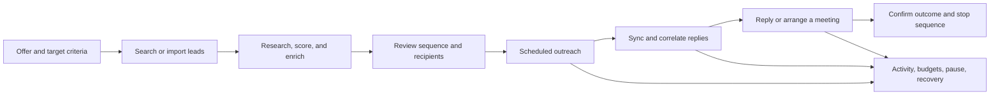

# Explee product and technical blueprint

The current [spec-driven build package](../specs/README.md) incorporates the user's Ceverio profile, three-country HVAC audience, autonomous workflow, Windows runtime, Supabase preference, and near-zero budget. It takes precedence over earlier implementation recommendations in this investigation blueprint.

Prepared 14 October 2026 for a personal internal tool. Status: **documented product/API baseline complete for the retrieved scope; authenticated source capture pending**.

The required outcome is a tool that finds relevant leads, researches and scores them, prepares and sends outreach, handles replies, and helps arrange meetings. It should cover the relevant Explee workflows without signup, billing, resale, or multi-user account management. External data, email, and scheduling providers remain real dependencies.

## What the evidence establishes

| Evidence class | Current result |
| --- | --- |
| Official product copy | Retrieved homepage, pricing, integration, and dataset descriptions. These establish advertised scope, not tested operation. |
| Published public contracts | Indexed 48 documented method/path pairs across selected API page views. No endpoint was executed; complete OpenAPI JSON is still unavailable. |
| REA runtime evidence for Explee | None. This chat cannot connect to the signed-in browser on the owner's computer. |
| REA tool verification | Real MCP connection, passive capture, network body shapes, screenshot pixels, bundle analysis, and Evidence export verified against a synthetic local page. |
| Internal-tool architecture | Explicit design proposal, separated from claims about Explee's backend. |

The source register is in [source-inventory.md](source-inventory.md). Machine-readable source references, retrieval times, coverage, and hashes are in [sources.json](../evidence/public/sources.json). Search snippets and page excerpts are not interchangeable with full source documents.

## Product coverage

The following requirements combine the user's stated goals with documented reference capabilities. Every row still needs authenticated observation before a faithful interaction/UI reproduction can be claimed.

| Capability to investigate or reproduce | Current basis | Personal-tool direction |
| --- | --- | --- |
| Offer and ideal-customer-profile setup | Advertised, EX-PUB-001 | Save the offer, target geography, criteria, exclusions, and tone as project settings. |
| Company and person search; natural-language filters | Documented, EX-PUB-004 | One provider adapter plus CSV import; retain query, filters, pagination, and provenance. |
| Criteria scoring and research | Documented/advertised, EX-PUB-004/006 | Explain scores with stored facts; distinguish unknown fields from negative matches. |
| Email/phone enrichment and async tasks | Documented, EX-PUB-004 | Enrich selected records, track provider jobs and verification dates, avoid duplicate charges. |
| Campaign planning, review, and approval | Documented, EX-PUB-004 | Versioned targeting and sequence previews with a chosen automation policy. |
| Own-lead import | Documented/advertised, EX-PUB-001/004 | Durable, resumable CSV import with row errors, deduplication, and provenance. |
| Personalized outreach and followups | Advertised/documented, EX-PUB-001/004 | Frozen message intents, sending windows, pacing, pause and stop rules. |
| Inbox, hot leads, notes, CC, attachments | Documented, EX-PUB-004 | Persistent threads and replies; provider-aware compose and lead history. |
| Automatic management and replies | Documented, EX-PUB-004 | Bounded project/campaign policies with visible state and recoverable actions. |
| Meeting-oriented outreach and scheduler links | Advertised, EX-PUB-001 | Existing Calendly/Cal.com/HubSpot link routing is the documented reference; direct calendar booking is a proposed extension. |
| Budgets, pause/resume, and analytics | Documented, EX-PUB-004 | Usage reservations, confirmed costs/outcomes, campaign controls, and clear metric populations. |
| Person/company deduplication and suppression | Documented, EX-PUB-004 | Stable identities and suppression checked immediately before dispatch. |
| HubSpot sync | Documented, EX-PUB-003 | Optional later adapter for interested leads, contact/company matching, and conversation history. |
| Managed warmed sending infrastructure | Advertised, EX-PUB-001 | Select a real mailbox/sending provider. Website inspection cannot recover this infrastructure. |

The detailed method/path index is in [documented-operations.json](../evidence/public/documented-operations.json). These are Explee's published public interfaces, not the signed-in frontend's captured private requests.

## Workflow specification

This is the proposed owner workflow. The backend contracts and UI action sequence must be reconciled with captures where parity matters.

The published campaign lifecycle includes discovery, review, and outreach; stopped campaigns can retain a listening state. Automatic management and restart behavior are mode-dependent. Preserve those distinctions in the source ledger rather than inferring the effect of a Start button from a state name. The proposed internal design treats its policy/version and queued actions as explicit records.

A meeting link is not proof that Explee reads calendar free/busy, creates events, or handles rescheduling directly. The user's meeting goal can be implemented through a booking provider or a separate calendar adapter, with that choice labeled as an implementation decision.

## Technical conclusions and limits

Published interfaces expose search/enrichment, asynchronous jobs, projects/campaigns, conversations, controls, and list management. These imply product responsibilities; they do not prove Explee's service boundaries, database, queue, framework, prompts, model vendor, or deployment architecture.

The public API uses an API-key contract. Its complete schema, live account-plan behavior, pagination edge cases, rate limits, errors, and equivalence to private frontend requests remain unverified. A generated client should wait for a complete valid schema or focused verified contracts.

The proposed internal system uses a local UI/API, SQLite, a durable worker, and data/mail/calendar adapters. See [the architecture](internal-tool-architecture.md) for records, recovery, deduplication, message/thread correlation, budgets, and meeting invariants. Those choices describe the future tool, not recovered Explee internals.

## Material recreation dependencies

| Dependency | Decision or evidence still needed |
| --- | --- |
| Lead data | Independent provider, optionally Explee's public API, or owned CSV data. A provider's advertised database cannot be reconstructed from browser code. |
| Sending and replies | Mailbox/account, API capabilities, sender identity, limits, and incoming sync. Explee-managed warmed mailboxes are a separate service dependency. |
| Meetings | Booking link/provider or calendar/account, duration, buffers, working hours, time zones, and invitation ownership. |
| Automation | Sending/reply policies, ceilings, stop conditions, and which ambiguous cases require owner review. |
| Runtime | Local-machine availability or a continuously running host. |
| UI fidelity | Accepted source screenshots, responsive states, DOM/style evidence, assets, and interactions. |

App signup and account management are omitted. Provider connection settings remain necessary to make lead data, email, and scheduling work.

## Source discrepancies

- Current retrieved pricing agrees with the homepage at $30 for 750 emails. An older indexed 1,000-email snippet is stale.
- Dataset pages publish different Maps dataset sizes/field counts. Preserve them as vendor claims until a selected data provider's actual contract is verified.
- Homepage import copy and API documentation describe validation timing differently. The captured app must resolve the distinction.
- Source observation starts when REA attaches. Empty request logs cannot establish that no earlier request occurred.

## Completion register

| Investigation question | Status | Remaining work |
| --- | --- | --- |
| Which capabilities are publicly documented? | Answered for retrieved scope | Expand if the signed-in inventory reveals additional features. |
| What public operations are documented? | Partially answered | Recover full OpenAPI and verify selected contracts when account integration is in scope. |
| What does the signed-in project show? | Unresolved | Run local capture at the selected project URL. |
| How do each screen and control behave? | Unresolved | Capture actions, stable states, errors, and mobile behavior. |
| What are the actual visual tokens/assets? | Unresolved | Source screenshots plus supported DOM/CSS/asset collection. |
| What private requests and frontend modules implement flows? | Unresolved | REA post-attach traces and captured bundle analysis. |
| How should the personal tool be built? | Proposed specification available | Choose providers/settings before real integration. |
| Is the capture kit executable? | Confirmed in synthetic Linux verification | Actual source capture and macOS/Windows runtime verification remain pending. |

The implementation sequence and measurable exit criteria are in [implementation-roadmap.md](implementation-roadmap.md). [local-capture.md](local-capture.md) makes the remaining source-collection step concrete.
