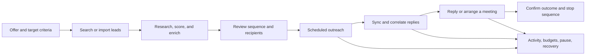

# Explee product and technical blueprint

The current [spec-driven build package](../specs/README.md) incorporates the user's Ceverio profile, three-country HVAC audience, autonomous workflow, Windows browser client, approved cloud/Supabase direction, and zero-spending constraint. It takes precedence over earlier implementation recommendations in this investigation blueprint.

Prepared 14 October 2026 for a personal internal tool. Status: **documented product/API baseline complete for the retrieved scope; authenticated source capture in progress; twenty-one bounded REA states accepted**.

The required outcome is a tool that finds relevant leads, researches and scores them, prepares and sends outreach, handles replies, and helps arrange meetings. It should cover the relevant Explee workflows without signup, billing, resale, or multi-user account management. External data, email, and scheduling providers remain real dependencies.

## What the evidence establishes

| Evidence class | Current result |
| --- | --- |
| Official product copy | Retrieved homepage, pricing, integration, and dataset descriptions. These establish advertised scope, not tested operation. |
| Published public contracts | Indexed 48 documented method/path pairs across selected API page views. No endpoint was executed; complete OpenAPI JSON is still unavailable. |
| REA runtime evidence for Explee | Twenty-one authenticated REA 6.4.0 states privately verified across overview/targeting/Companies/Docs/Domains/integrations/inbox/thread/status/Lead info/suppression/schedule. Targeting has supplemental native style measurements and bounded request observations. Other source groups and full interaction coverage remain pending. |
| REA tool verification | Real MCP connection, passive capture, network body shapes, screenshot pixels, bundle analysis, and Evidence export verified against a synthetic local page. |
| Internal-tool architecture | Explicit design proposal, separated from claims about Explee's backend. |

The source register is in [source-inventory.md](source-inventory.md). Machine-readable source references, retrieval times, coverage, and hashes are in [sources.json](../evidence/public/sources.json). Search snippets and page excerpts are not interchangeable with full source documents.

## Accepted source states and component catalog

This ledger covers saved overview initial desktop, targeting top/lower desktop/mobile, Companies desktop, Project docs desktop/mobile, Domains desktop, integrations, inbox/thread/status/Lead info, suppression and schedule viewports. Full interaction/fidelity acceptance is still pending. Private references and hashes are in the [overview record](../evidence/source-state-overview-20261015.json) and [targeting record](../evidence/source-state-targeting-20261015.json), with the [responsive checkpoint](../evidence/source-state-targeting-responsive-20261015.json).

| State | Observed presentation | Remaining evidence | Requirement / acceptance links |
| --- | --- | --- | --- |
| `EX-OV-D-001` | Authenticated dashboard/navigation, setup/usage notices, performance cards and filter controls. Values remain private. | Lower page, filter/notice interactions, mobile, computed styles and metric semantics. | REQ-REF-001/002/003; ACC-023/031 |
| `EX-TG-D-001` | Targeting inheritance selector, Geography and Company size criteria blocks with suggestion controls. | Variant states and validation/save semantics; see lower/mobile additions below. | REQ-REF-001/002/003, REQ-DATA-001; ACC-023/025/031 |
| `EX-TG-D-002` | Lower targeting form and disabled Save & re-search; main scroll extent aligned with top view. | Drawer/variants and persistence semantics. | REQ-REF-001/002/003; ACC-023/031 |
| `EX-TG-M-001` | Whole criteria form at 390 × 844, hidden sidebar and Open navigation control. | Drawer REA screenshot, criteria editing and validation. | REQ-REF-001/002/003; ACC-023/031 |
| `EX-LD-D-001/002` | Existing campaign Companies list and agent/history split pane at 980 × 569 and 1366 × 577. | Horizontal/bottom/detail/mobile states, scoring/selection/import and API semantics. | REQ-REF-001/002/003, REQ-DATA-002/006; ACC-023/025/031/032 |
| `EX-PD-D-001/002` | Project docs top/lower desktop: Company profile, competitors, Reply facts and Files. | Editing/validation/persistence, competitor disclosure and file behavior; failed source imagery retained. | REQ-REF-001/002/003, REQ-DATA-001; ACC-023/025/031 |
| `EX-PD-M-001/002` | Project docs paired 390 × 844 top/clean lower views. | Interaction variants; source cohorts changed on reload, so no atomic cross-version composite claim. | REQ-REF-001/002/003, REQ-UI-001; ACC-023/024/031 |
| `EX-DM-D-001/002/003` | Domains/mailboxes top, middle and FAQ lower at 980 × 569; DNS/existing-domain disclosures expanded. | Initial timeline end clipped; horizontal/mobile/configuration behavior unresolved. FAQ is source guidance. | REQ-REF-001/002/003, REQ-INT-001; ACC-023/031/032 |
| `EX-IG-D-001` | Integrations initial desktop at 980 × 569. | Custom/API guidance now shown in wider `EX-IG-D-002`; connection behavior/permissions and mobile unresolved. | REQ-REF-001/002/003, REQ-INT-001; ACC-021/023/031/032 |
| `EX-IB-D-001` | Needs reply empty queue and unselected conversation pane at 980 × 569. | Thread/list/status/Lead info now presented in `EX-IB-D-002/003/004`; mobile and classification/reply workflow semantics remain pending. | REQ-REF-001/002/003, REQ-IN-001, REQ-UI-001; ACC-011/023/024/031 |
| `EX-IB-D-002/003/004` | Existing selected thread/list with untouched pre-existing composer text, unassigned status popover and Lead info at 1534 × 881. | Earlier history/other recipients/filters/compose/mobile unresolved; five status choices plus Add distinct from reply classification. Public exact URL identifier redacted. | REQ-REF-001/002/003, REQ-IN-001/005, REQ-UI-001; ACC-011/023/024/031/032 |
| `EX-IG-D-002` | Wider whole-page integrations including Custom/API guidance at 1534 × 881. | Connection/copy/API controls uninvoked; source GET example is not an observed request. | REQ-REF-001/002/003, REQ-INT-001; ACC-021/023/031/032 |
| `EX-SP-D-001` | Organization-wide suppression upload/domain affordances at 1534 × 881. | Last 67 pixels, validation/import/matching and mobile pending; controls uninvoked. | REQ-REF-001/002/003, REQ-DATA-004; ACC-012/023/031 |
| `EX-SC-D-001` | Project country/day/local-time matrix, Smart sending days and disabled Saved at 1534 × 881. | No edits/execution/DST/error/mobile verification; matrix is separate from approved ICP. | REQ-REF-001/002/003, REQ-OUT-004; ACC-016/023/031/032 |

| Component family | Observed evidence | Contract/style status |
| --- | --- | --- |
| Project navigation shell | The accepted desktop views show the project selector, grouped navigation and campaign section. | Mobile targeting hides the sidebar and exposes Open navigation. Drawer native measurements are provisional; destination inventory continues. |
| Dashboard notices and metric cards | `EX-OV-D-001` screenshot/accessibility. | Presentation observed; control effects and metric definitions unverified. |
| Inheritance selector and criteria blocks | `EX-TG-D-001` screenshot/accessibility. | Visible labels/presentation observed; selector transitions, parsing, suggestion effects and persistence unverified. |
| Companies grid | Ten columnheader DIVs and grid cells in a scoped `role=grid` surface. | Initial split-pane presentation accepted; historical chat tables excluded. UI field attributes do not prove API fields. |
| Project docs sections | Company profile textarea, competitor chips, Reply facts prompts/documents and Files dropzone in paired desktop/mobile views. | Presentation accepted; persistence/validation/upload behavior untested. Changed source cohorts remain explicit. |
| Typography/assets | Two loaded stylesheet URLs and two font URLs were inventoried by REA; four separately fetched files are privately hash-verified. CSS declares GeistSans and GeistMono. | Native targeting computed styles/rects at matching desktop/mobile viewports observe GeistSans body, 16px/24px, weight 400 and visible text sizes 12/14/16/18px; 16 visible inline SVGs retained. Complete icon/image/variant catalog pending. Loaded-byte identity and reuse permissions are not inferred from URL matches. |

Initial idle windows recorded zero requests. A subsequent real REA window retained 23 requests, including typed responses for unread counts (`by_project`, `by_segment`: object) and LinkedIn access (`arm`: null observed, `live`: boolean). It did not complete the attempted Docs navigation. Prefetched routes do not establish visited screens, and an opaque page POST has undetermined effects. No validation or save contract is recovered. Existing proposed [workflow/data/API contracts](../specs/contracts.md) remain independent designs until relevant read transitions are observed.

The [16 October group record](../evidence/source-state-leads-docs-20261016.json) contains six privately accepted bounded states. Companies uses a DIV-based `role=grid` with NAME, DOMAIN, DESCRIPTION, GEO, SIZE, INDUSTRIES (NACE), CITY, HIRING, EMAILS and TRAFFIC headers. Scoped native measurement distinguishes this current grid from historical chat tables; UI field labels/attributes are not API-contract proof. Both desktop views are bounded split panes; horizontal/bottom/detail/mobile views remain pending. Project docs paired desktop/mobile views show Company profile, competitors, Reply facts and Files. Clean lower mobile replaces an occluded candidate. Source client cohorts changed on reload; no atomic cross-version or loaded-byte equivalence is asserted. Native style measurements supplement these views, while all other native-only screens remain provisional.

The [17 October operations record](../evidence/source-state-operations-20261017.json) adds five accepted source presentations. Domain/mailbox controls and expanded FAQ are observed without configuration/order effects. Integrations acceptance covers its top viewport only. Needs reply acceptance covers an empty queue/unselected pane only. The selected-thread attempt was rejected when its exact URL changed; later thread candidates require separate acceptance and redacted public URL attribution. No private API/workflow contract or application acceptance scenario is established by these presentation captures.

The [second 17 October group](../evidence/source-state-inbox-suppression-schedule-20261017.json) adds six larger desktop views. Pre-existing composer text was preserved without generation/edit/send. Lead status is distinct from reply classification. Custom/API guidance was displayed without copy/connect/API invocation. Suppression and schedule controls were not exercised; organization scope and operational country settings do not change approved Ceverio targeting. Public thread URLs redact the private person identifier and reference exact private receipts. Native metadata and still-pending transition evidence do not establish additional accepted workflows.

## Product coverage

The following requirements combine the user's stated goals with documented reference capabilities. The twenty-one accepted viewports provide the bounded observations above; every workflow still needs sufficient interaction/mobile/style evidence before faithful reproduction can be claimed.

| Capability to investigate or reproduce | Current basis | Personal-tool direction |
| --- | --- | --- |
| Offer and ideal-customer-profile setup | Advertised, EX-PUB-001 | Save the offer, target geography, criteria, exclusions, and tone as project settings. |
| Company and person search; natural-language filters | Documented, EX-PUB-004 | One provider adapter plus CSV import; retain query, filters, pagination, and provenance. |
| Criteria scoring and research | Documented/advertised, EX-PUB-004/006 | Explain scores with stored facts; distinguish unknown fields from negative matches. |
| Email/phone enrichment and async tasks | Documented, EX-PUB-004 | Enrich selected records, track provider jobs and verification dates, avoid duplicate charges. |
| Campaign planning, review, and approval | Documented, EX-PUB-004 | Versioned targeting and sequence previews with a chosen automation policy. |
| Own-lead import | Documented/advertised, EX-PUB-001/004 | Durable, resumable CSV import with row errors, deduplication, and provenance. |
| Personalized outreach and followups | Advertised/documented, EX-PUB-001/004 | Frozen message intents, sending windows, pacing, pause and stop rules. |
| Inbox, hot leads, notes, CC, attachments | Documented, EX-PUB-004 | Persistent threads and replies; provider-aware compose and lead history. |
| Automatic management and replies | Documented, EX-PUB-004 | Bounded project/campaign policies with visible state and recoverable actions. |
| Meeting-oriented outreach and scheduler links | Advertised, EX-PUB-001 | Existing Calendly/Cal.com/HubSpot link routing is the documented reference; direct calendar booking is a proposed extension. |
| Budgets, pause/resume, and analytics | Documented, EX-PUB-004 | Usage reservations, confirmed costs/outcomes, campaign controls, and clear metric populations. |
| Person/company deduplication and suppression | Documented, EX-PUB-004 | Stable identities and suppression checked immediately before dispatch. |
| HubSpot sync | Documented, EX-PUB-003 | Optional later adapter for interested leads, contact/company matching, and conversation history. |
| Managed warmed sending infrastructure | Advertised, EX-PUB-001 | Select a real mailbox/sending provider. Website inspection cannot recover this infrastructure. |

The detailed method/path index is in [documented-operations.json](../evidence/public/documented-operations.json). These are Explee's published public interfaces, not the signed-in frontend's captured private requests.

## Workflow specification

This is the proposed owner workflow. The backend contracts and UI action sequence must be reconciled with captures where parity matters.

The published campaign lifecycle includes discovery, review, and outreach; stopped campaigns can retain a listening state. Automatic management and restart behavior are mode-dependent. Preserve those distinctions in the source ledger rather than inferring the effect of a Start button from a state name. The proposed internal design treats its policy/version and queued actions as explicit records.

A meeting link is not proof that Explee reads calendar free/busy, creates events, or handles rescheduling directly. The user's meeting goal can be implemented through a booking provider or a separate calendar adapter, with that choice labeled as an implementation decision.

## Technical conclusions and limits

Published interfaces expose search/enrichment, asynchronous jobs, projects/campaigns, conversations, controls, and list management. These imply product responsibilities; they do not prove Explee's service boundaries, database, queue, framework, prompts, model vendor, or deployment architecture.

The public API uses an API-key contract. Its complete schema, live account-plan behavior, pagination edge cases, rate limits, errors, and equivalence to private frontend requests remain unverified. A generated client should wait for a complete valid schema or focused verified contracts.

The approved direction is a privately hosted cloud UI/API and durable worker, Supabase/PostgreSQL persistence, and independent data/mail/calendar adapters. The owner's Windows browser is a client; it does not host the application or inference. [The cloud deployment plan](../specs/cloud-deployment.md), [product specification](../specs/product.md), and [current contracts](../specs/contracts.md) govern this topology. The [architecture](internal-tool-architecture.md) describes recovery, deduplication, message/thread correlation, budgets, and meeting invariants within that direction. This supersedes the earlier local/SQLite recommendation in this blueprint. These are independent design decisions, not recovered Explee internals.

## Material recreation dependencies

| Dependency | Decision or evidence still needed |
| --- | --- |
| Lead data | Independent provider, optionally Explee's public API, or owned CSV data. A provider's advertised database cannot be reconstructed from browser code. |
| Sending and replies | Mailbox/account, API capabilities, sender identity, limits, and incoming sync. Explee-managed warmed mailboxes are a separate service dependency. |
| Meetings | Booking link/provider or calendar/account, duration, buffers, working hours, time zones, and invitation ownership. |
| Automation | Sending/reply policies, ceilings, stop conditions, and which ambiguous cases require owner review. |
| Runtime | Verified private cloud host; Windows remains the owner browser/capture client. |
| UI fidelity | Accepted source screenshots, responsive states, DOM/style evidence, assets, and interactions. |

App signup and account management are omitted. Provider connection settings remain necessary to make lead data, email, and scheduling work.

## Source discrepancies

- Current retrieved pricing agrees with the homepage at $30 for 750 emails. An older indexed 1,000-email snippet is stale.
- Dataset pages publish different Maps dataset sizes/field counts. Preserve them as vendor claims until a selected data provider's actual contract is verified.
- Homepage import copy and API documentation describe validation timing differently. The captured app must resolve the distinction.
- Source observation starts when REA attaches. Empty request logs cannot establish that no earlier request occurred.

## Completion register

| Investigation question | Status | Remaining work |
| --- | --- | --- |
| Which capabilities are publicly documented? | Answered for retrieved scope | Expand if the signed-in inventory reveals additional features. |
| What public operations are documented? | Partially answered | Recover full OpenAPI and verify selected contracts when account integration is in scope. |
| What does the signed-in project show? | Partially observed | Accepted bounded overview/targeting/leads/Docs evidence. Other native screens remain provisional. |
| How do each screen and control behave? | Unresolved | Capture actions, stable states, errors, and mobile behavior. |
| What are the actual visual tokens/assets? | Partially observed | Targeting measurements and retained CSS/fonts; complete component/variant catalog and client-cohort reconciliation remain. |
| What private requests and frontend modules implement flows? | Unresolved | REA post-attach traces and captured bundle analysis. |
| How should the personal tool be built? | Proposed specification available | Choose providers/settings before real integration. |
| Is the capture kit executable? | Confirmed on Windows for selected source states and historical Linux fixture | Remaining reliability/coverage limits are recorded; macOS execution remains unverified. |

The implementation sequence and measurable exit criteria are in [implementation-roadmap.md](implementation-roadmap.md). [local-capture.md](local-capture.md) makes the remaining source-collection step concrete.
