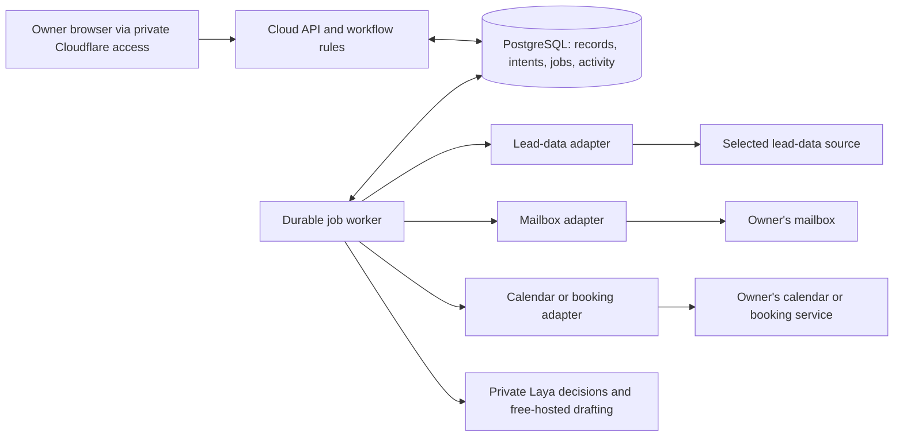
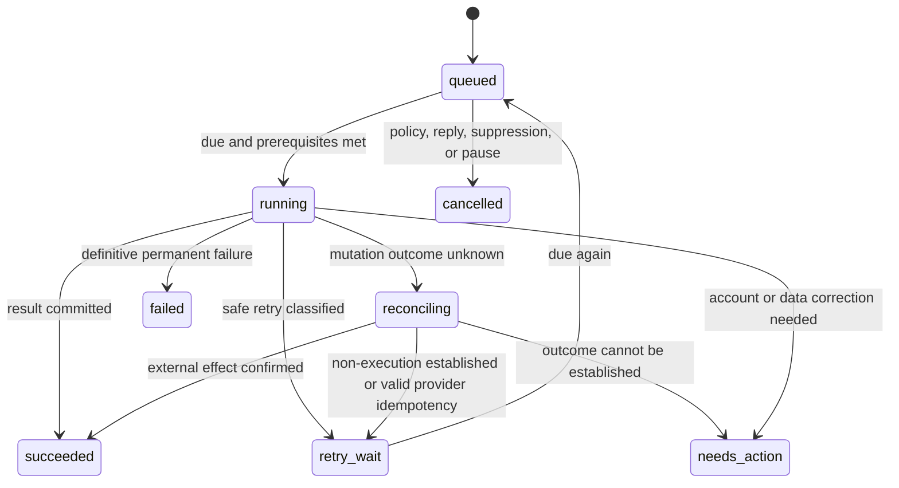

# Proposed architecture for the internal lead-to-meeting tool

Status: design proposal, updated 14 October 2026. The current [build specification](../specs/README.md) and [contracts](../specs/contracts.md) take precedence where they refine this earlier blueprint. This document specifies the user's future single-user tool, not Explee's backend implementation. Authenticated Explee screens and private runtime contracts have not been captured.

The approved outcome is a product and technical blueprint first, followed by a personal tool that finds leads, contacts them, handles replies, and arranges meetings. The tool has no signup, billing, tenancy, or multi-user account management. Connecting a lead-data service, mailbox, or calendar still requires that provider's account credentials or OAuth authorization.

Explee's [published API documentation](https://api.explee.com/public/api/docs) and [OpenAPI document](https://api.explee.com/public/api/openapi.json) are public reference material. Published functionality is documented evidence, not proof that an authenticated workflow has been observed. Visual structure and exact source behavior remain subject to reference capture.

## Starting architecture

Use a browser UI, a private cloud API, one durable database, and a small job worker. The current target is an eligible Oracle ARM VM with private Cloudflare owner access, selected Supabase persistence and private Laya inference. See the authoritative [cloud plan](../specs/cloud-deployment.md); the earlier Windows-local-first topology is superseded.

| Choice | Proposed starting point | Reason or boundary |
| --- | --- | --- |
| UI | React and TypeScript; exact components follow captured reference screens | Supports dense lead tables, previews, inbox threads, and activity views. |
| API and worker | Node 24 and TypeScript on eligible cloud CPU; shared validated domain/provider contracts | Python is isolated for Laya and the REA kit. Verify ARM runtime/dependencies. |
| Persistence | PostgreSQL with versioned migrations; private schema in selected Explee REA Supabase project | Access, Free plan, region and returned table inventory are confirmed. Application grants, usage, host connectivity and isolated migrations remain future work. |
| Queue | Database-backed jobs; one mutation worker initially | Avoids additional operational infrastructure. Reads and independent enrichments can gain bounded concurrency later. |
| App access | Bind VM app to loopback behind private Cloudflare Access/Tunnel; shared UI/API origin; validate Host and reject foreign origins on writes | No app signup; external owner access must be verified before exposure. |
| Email | Google capability requested; actual Ceverio sender and permitted campaign provider unresolved | Connected personal Gmail is not automatically the Ceverio sender. Zoho Mail's policy excludes automated promotional campaigns. |
| Meetings | Existing booking link selected; Google Calendar capability requested | Booking-service events establish confirmed outcomes. Direct calendar slot negotiation is deferred. |
| Model | Self-hosted Laya decision candidate; evaluated free-hosted open-weight drafting | Rules/templates and recovery remain functional. Model quality, context and free-entitlement gates precede automatic proposals. |

The cloud worker operates independently of laptop sleep, subject to actual host/database/provider availability. On restart, uncertain effects reconcile and overdue outreach is paced under current policy. Free capacity and recovery must be verified before release.

## Core records

IDs are local stable IDs. Provider IDs are additional identifiers. Store timestamps in UTC and preserve the IANA time zone needed to interpret a meeting or schedule. Default display time zone: `Africa/Johannesburg`; campaign and recipient time zones can differ.

| Record | Minimum durable information |
| --- | --- |
| Project | Offer, ideal customer profile, search criteria, exclusions, default time zone, budgets, automation policy and version. |
| SearchRun / ImportRun | Original query or import hash, validated filters, provider, pagination/cursor, async provider job ID, status, progress, quoted/reserved/actual usage. |
| Company | Name, normalized website domain, source identities, aliases, selected attributes. |
| Contact / ContactEndpoint | Person, company relationship, role, verified individual addresses or shared endpoints, verification date, phone if available, suppression state. |
| SourceObservation | Provider or import, external record ID or row reference, source URL when available, fetch time, artifact hash, field-level facts and citations. |
| Campaign / SequenceVersion | Project, sending account, target rules, immutable sequence version, send windows, spacing, caps, review/autopilot policy. |
| Enrollment | Contact, campaign/version, current step, stage, next action time, last send, stop reason, optimistic version. |
| OutboundIntent | Stable logical action key, recipient envelope, rendered subject/body, content hash, references to facts, policy/review version, send state, provider identifiers. |
| Thread / Message | Connection ID, provider thread/message IDs, RFC Message-ID, References/In-Reply-To, direction, sender/recipients, body, attachments, received/sent time, classification. |
| Meeting | Contact and thread, offered slots, selected UTC interval and time zone, calendar/booking provider, stable event ID, event revision, status. |
| Job | Kind, entity reference, operation key, expected entity version, due time, attempt count, lease token/deadline, last classified error. |
| Connection | Provider/account identity, capability flags, credential reference, sync cursor, last successful sync, authentication status. |
| Activity / LeadNote / Suppression | Append-only state changes, actor and job correlation, user notes, suppression reason and originating message/event. |

Credentials live in an OS credential store or an equivalent configured secret store. Database rows hold references, never copied OAuth tokens in job payloads. Mail bodies and lead facts remain necessary application data; routine logs contain IDs and error classes rather than credentials or complete messages.

### Identity and deduplication

- Map each `(provider, record kind, external record ID)` to one local entity. Reingesting a page updates its source observations without creating another entity.
- Normalize domains and canonical profile URLs. Trim addresses and normalize their domains; preserve original spelling and use provider-confirmed rules for local-part equivalence. Do not generally remove plus suffixes or dots.
- Auto-merge only strong, non-conflicting individual identities. A similar name and company creates a merge suggestion. A shared role mailbox is an endpoint, not proof that two people are the same contact.
- Preserve source history and manual corrections when merging. Update foreign keys transactionally and reject a merge that would produce two active outreach sequences.
- Use unique `(connection ID, provider message ID)` and `(connection ID, provider thread ID)` constraints for email ingestion. Logical sends, meetings, and jobs each have stable unique operation keys.
- Allow one active outreach enrollment per contact initially. Also check canonical recipient endpoints so two unmerged contacts cannot receive simultaneous sequences at the same address. Deliberate reenrollment creates a new cycle, with prior messages retained.
- Apply suppression and exclusion lists at import/enrollment and again immediately before sending. Importing the same lead again cannot clear suppression.

## Provider seams

These are proposed internal interfaces, not recovered Explee endpoints. Adapters return normalized data plus source identities, capability information, and classified errors.

| Adapter | Required capabilities | Candidates / important distinction |
| --- | --- | --- |
| LeadData | Search/filter, paginate, get/poll asynchronous results, enrich selected contacts/companies, report provenance and known usage | An independent licensed provider or CSV import. Explee's public API is an optional adapter; its documented company/people search, criteria scoring, and email/phone enrichment must be checked against the selected API version and account plan. No ongoing Explee dependency is assumed. |
| Mailbox | Send a frozen message intent, fetch sent-message evidence, incrementally sync messages/threads, send a correlated reply, list attachments | Gmail is a candidate. Declare whether provider idempotency exists and its lifetime; Message-ID alone is not a Gmail send idempotency guarantee. |
| Calendar | Query availability, create/get/update/cancel a stable event, preserve event versions where supported | Google Calendar is a candidate. Verify selected-calendar permissions, event-ID format, invitation behavior, and conferencing capabilities during adapter implementation. |
| BookingService | Resolve a configured booking link, ingest booking/reschedule/cancel events, correlate attendee to contact/campaign | Optional existing Calendly, Cal.com, or HubSpot Meetings account. Verify each provider's supported event mechanism rather than assuming equivalent APIs. |
| Drafting / Classification | Generate a draft from cited facts; classify a reply into a bounded schema; propose a permitted next action | Laya and free Cloudflare drafting are candidates under the model spec. Models cannot send, book, run code, or change workflow policy directly. |

A common error taxonomy is `retryable_read`, `rate_limited`, `authentication_required`, `invalid_request`, `budget_blocked`, and `mutation_outcome_unknown`. Raw provider error details are retained in a redacted diagnostic record. The UI translates them into an action the owner can take.

Connecting accounts is an integration setting, not an app authentication layer. Revocation or token expiration pauses affected jobs, preserves their intents, and exposes reconnect status. It does not drop leads or silently switch sending accounts.

## Lead discovery and preparation

1. Save the project brief and explicit search criteria. A natural-language query may produce a validated filter plan, which is visible before a paid search runs.
2. Create a SearchRun and any known usage reservation transactionally. Persist provider async job IDs and pagination checkpoints before continuing.
3. Ingest each page in a transaction, preserving provenance and verification dates. Resume from the checkpoint after interruption; uniqueness constraints make reingestion safe.
4. Enrich selected leads rather than every result automatically. Maintain an explainable criteria score with supporting facts; missing evidence remains missing.
5. Create a sequence preview using factual references, the user's offer, and template/version metadata. Show missing fields and unresolved addresses before enrollment.

CSV is the useful provider-independent baseline. Stream imports, validate rows, report accepted/rejected/merged counts, and retain row-level errors. Explee's published import limit is a reference capability to investigate; the internal tool's supported volume must be measured rather than inherited from that claim.

Paid-provider accounting separates quoted, reserved, actual, and unknown cost. Keep ambiguous reservations until reconciliation. A hard spending guarantee is possible only when the selected provider exposes enough usage and pricing information; otherwise show that limitation in the project budget view.

## Campaign, email, and reply behavior

The user selected bounded autonomous discovery, outreach, and replies. Activation stores the project policy and permitted factual actions once; it does not require daily batch approval. Scheduled work follows that stored policy and current prerequisites. Editing a policy increments its version and invalidates incompatible pending jobs. The controlled pilot and provider/recipient gates still apply.

For each due email:

1. Confirm current enrollment/version, campaign state, sending window, verified recipient, exclusions, suppression, budget/cap, and mailbox health. Refresh relevant incoming messages before a followup.
2. Freeze the recipient envelope, message content, stable Message-ID, and logical key such as `enrollment / cycle / sequence version / step`. Create the OutboundIntent, job, usage reservation, and activity entry in one transaction.
3. Claim the job with an atomic database update and lease token. Record `sending` before calling the provider; do the network call outside the database transaction.
4. On a confirmed response, persist provider message/thread IDs and mark `accepted`. Schedule the next step under the current enrollment version. Provider acceptance is not evidence of inbox delivery or an open.
5. On a timeout, lost connection, process crash after dispatch, or potentially accepted server error, mark the mutation for reconciliation. Query sent-message evidence using available provider IDs, stable Message-ID, and envelope metadata. Never blindly resend an uncertain Gmail send.

When an adapter offers genuine idempotency, reuse the same key and identical payload within its documented validity window. A new key is a new send. When an adapter cannot prove whether a send occurred, leave it in `needs_action` with the original intent; absence from a delayed search result is not proof of non-delivery.

Inbox ingestion saves messages and checkpoints durably. Only advance an incremental cursor after the corresponding messages are committed. Recover an expired cursor with a bounded resync and existing message IDs. Correlate replies using provider thread IDs and RFC reply references first; sender/subject similarity is a fallback requiring review.

The first correlated inbound reply pauses the outreach sequence. Classification can then label interest, objection, opt-out, bounce, auto-reply, or ambiguous intent. Opt-outs, hard bounces, and booked meetings stop future outreach and create a visible reason. A known automatic response can resume only under the campaign's configured rule. Manual pause or reply also invalidates queued followups. A pause cannot cancel an already dispatched provider request; record and reconcile any resulting send without scheduling more outreach.

Externally sourced mail and attachments are content, not commands. Parse and size-bound text, keep original messages available, and pass a delimited representation to a classifier that has no operational tools. Automatic action is limited to a matched contact/thread and an allowed structured intent. Thread IDs and reply headers correlate conversations; they do not authenticate a sender. Respect available provider spam/authentication signals and send identity conflicts or forwarded-message ambiguity to review. A request to change accounts, export data, run code, or contact unrelated addresses goes to `needs_action`. Unknown senders remain visible but cannot create autonomous sends or bookings.

There is an unavoidable race if a reply arrives after the last mailbox refresh but before the provider accepts a followup. The tool can minimize this interval and display the last sync time; it cannot promise an atomic mailbox-read-and-send operation across providers.

## Meeting scheduling

The initial workflow uses a validated existing booking link and synchronizes authoritative booking/reschedule/cancellation events. Link sent, booked, attendee accepted, and completed remain distinct. The direct-calendar rules below apply only if that deferred capability is subsequently selected; they are not first-release commitments.

- Store meeting duration, buffers, working hours, relevant calendars, time zones, and offered-slot expiration as explicit settings. Render dates in the recipient's stated zone; never guess a zone from the execution host.
- Hold a selected slot locally in a short-lived record. Transactionally reject overlap with other active local holds/bookings, including configured buffers. Recheck external free/busy immediately before creation.
- Create a stable external event ID derived from the meeting intent where the selected provider supports caller-defined IDs. A Google Calendar candidate is the first 32 lowercase hex characters of `SHA-256("meeting:" + local_intent_id)`; validate it against the selected API's event-ID rules. A duplicate-ID response triggers a fetch and comparison, not another event with a different ID.
- Persist the provider event ID, attendee, interval, conference information, and version before marking `booked`. A timeout is reconciled by fetching that same event ID. An unmatched existing event becomes `needs_action`.
- Use event revisions for rescheduling and cancellation. Apply conditional updates where the adapter supports them; refetch and resolve conflicting external edits rather than overwriting them. Calendar-generated invitations and separate outreach messages are tracked as different effects.
- Ingest booking-service events idempotently and stop the correlated sequence when a meeting is confirmed. Verify provider-origin events if a webhook adapter is introduced.

A local hold cannot reserve time against unrelated external calendar writes. The final free/busy check reduces conflicts, but an API without atomic conditional reservation can still race. Surface the conflict and offer new slots instead of claiming guaranteed prevention of every double booking.

## Job states and recovery

Required invariants:

1. A job refers to a durable domain intent; a job retry does not create another logical action.
2. Only the worker with the current lease token may advance completion. Retryability is classified by actual effects and billability: confirmed non-effectful reads/polls can retry, while uncertain enrichment starts, paid searches, and mutations reconcile first. Retain late provider responses against their original intent for reconciliation.
3. A response is written with its activity record and resulting next state in one transaction. Worker crashes cannot leave a locally completed operation without its provider reference.
4. A state-changing reply or pause increments the enrollment version. A stale scheduled job cannot advance the sequence or dispatch another action.
5. Automatic retries use bounded exponential backoff with jitter and provider `Retry-After` where supplied. Authentication and invalid-data errors wait for correction. Retries of external mutations require outcome-aware handling.
6. Attempt limits and operation deadlines are visible. A permanently stuck job cannot silently hold the entire queue; affected campaign/contact work pauses with a recoverable reason.
7. Restoring a backup starts with dispatch paused. Reconcile the entire snapshot-to-present external uncertainty interval, including actions that appear queued or are absent in the snapshot but executed later. Unavailable history leaves affected work paused.

An Activity view exposes each lead's search/enrichment, draft, send, reply, stop, and booking history. It offers pause, resume, reconnect, review, retry a safe operation, and reconcile an uncertain one. Do not label an unknown mutation as a routine retry.

## Documented capabilities and proposed extensions

Publicly documented Explee capability families are reference targets, not commitments to identical internals. The source inventory must hold their exact documented evidence and remaining capture gaps.

| Documented family | Proposed representation / priority |
| --- | --- |
| Company/people search; criteria scoring; email/phone enrichment; async jobs | LeadData adapter, SourceObservation, SearchRun, explainable scores. Core discovery path. |
| Projects/campaigns; review/approval; own-lead import | Project, versioned campaigns, preview/start actions, streamed CSV import. Core outreach preparation. |
| Inbox tabs/threads/replies/CC/attachments/lead notes | Persistent inbox filters, thread-aware compose, bounded attachments, notes. Core replies first; advanced compose later. |
| Budgets/pausing; dedup lists | Usage ledger, campaign controls, suppression/exclusion and merge workflow. Core controls. |
| Hot-lead feed; analytics | Derived feed of interested replies and booked leads; campaign counts with explicit denominators and date windows. Subsequent visibility. |
| Autopilot/auto-reply | Versioned bounded automation policies and permitted intents. Enable after reply and send recovery passes acceptance. |
| Booking-link routing | Optional adapter to the owner's existing booking service. Direct calendar booking is another implementation choice. |
| Advertised pooled inboxes | Do not assume these are user-owned mailboxes or recreate the provider infrastructure. Multiple owned connections are a possible later extension with per-account limits. |

Analytics use locally confirmed search/import, provider-accepted sends, correlated replies, classified interested contacts, and confirmed bookings. Define whether each measure counts contacts, enrollments, messages, or meetings. Do not display delivery or open rates unless the selected provider supplies evidence for them. Unknown charges and unconfirmed sends remain visible instead of becoming successful counts.

## Unresolved implementation choices

| Decision | Working proposal | Needed before live integration |
| --- | --- | --- |
| Lead data | CSV first; then one independent provider or optionally Explee's public API | Provider/account, fields, geography, verification coverage, permitted usage, pricing and API limits. |
| Mailbox | Gmail candidate | Sender account, available API permissions, send/reply capabilities, explicit campaign ceilings. |
| Calendar/booking | Google Calendar candidate; hosted link optional | Calendar ID, availability, duration/buffers, meeting time zones and invitation/conferencing behavior. |
| Runtime | Whole-cloud app/worker; Windows 11 owner browser | Oracle capacity, private Cloudflare access and free-tier/recovery feasibility remain to be established. |
| Automation | Bounded autonomous discovery/outreach/replies selected | Exact Explee categories require source capture; unsupported/ambiguous factual actions enter review. |
| Personalization | Templates plus cited facts; optional model | Offer, tone, useful inputs, model/provider and cost allowance if used. |
| Scale | One owner, one sending account initially | Typical lead/import volume, sending volume, and provider budgets. |
| Source fidelity | Preserve inspected workflows and visual evidence when available | Authenticated source captures and unresolved feature behavior. |

These dependencies do not block completing the specification. The selected faithful interface requires source/design acceptance before application scaffolding; external-account dependencies govern real-provider acceptance. See [the current execution plan](../specs/build-plan.md) for the authoritative sequence and checks.
