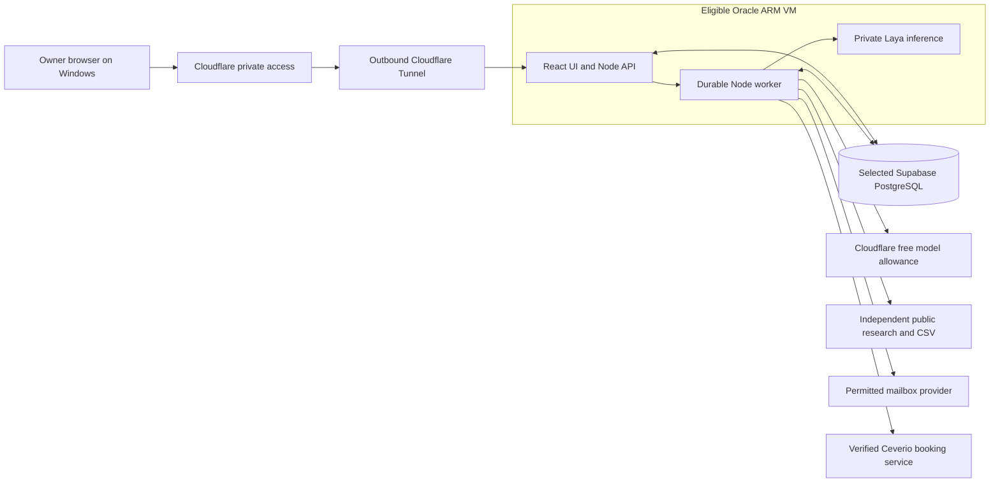

# Cloud deployment and zero-spending plan

Status: planning only, 15 October 2026. The user selected **the whole application in the cloud** and reports an Oracle Free Tier account in US East (Ashburn). Native Cloudflare MCP verifies ceverio.com's active Free zone and the supplied export comparison; DNSSEC is pending and the registrar DS has not yet been added. This supersedes Windows-local-first. This work created no account, VM, tunnel, model endpoint, database schema or deployment.

The [remaining-layer plan](remaining-layers.md) and [Ceverio DNS status/steps](dns-cutover.md) provide current account facts, completed activation observations and remaining registrar/service checks.

## Recommended target

Use an eligible **Oracle Always Free ARM VM in the reported Ashburn home region** for the React/Node application, durable worker and private Laya Python sidecar. Use the selected **Explee REA Supabase project** for PostgreSQL persistence. Use the confirmed **Cloudflare** account for proposed leads.ceverio.com private browser access and a drafting allowance verified under the actual Workers plan.

This keeps heavy inference off the laptop and lets the worker operate while the laptop sleeps, subject to host/database/provider availability. The existing Node/Postgres design is retained; a Cloudflare serverless application port is a separate contingency, not a claim that a Node daemon can deploy unchanged to Workers.

The screenshots establish an i7-8650U laptop, 8 GB RAM, integrated UHD 620 graphics and roughly 39 GB unused storage. The displayed 82% memory use was a momentary observation. Shared GPU memory was not measured; the 128 MB figure is not a complete statement of usable graphics memory. A lightweight browser and optional local development client remain feasible; heavy local inference is not the primary plan.

These are proposed boundaries, not deployed services.

## Verified public options

| Option | Current documented allowance / condition | Role and limitation |
| --- | --- | --- |
| Cloudflare Workers AI | 10,000 Neurons/day on Workers Free; exceeding the allocation fails. Some models require paid access. | Best immediate candidate for bounded open-weight drafting. It hosts its catalog, not arbitrary Laya weights. Actual account plan/model access must be verified. |
| Oracle Always Free A1 | Currently 1,500 OCPU-hours and 9,000 GB-hours/month, described as 2 OCPUs/12 GB for free tenancies; 200 GB shared free block-volume allocation. | Candidate for the Node worker and CPU Laya. Capacity may be unavailable and idle VMs can be reclaimed; no free SLA. Card verification may involve temporary holds. |
| Hugging Face ZeroGPU | Eligible verified personal accounts older than 30 days can host two Gradio Spaces; free-user GPU quota is five minutes/day. | Optional model evaluation/low-volume inference, with queues, daily limits and Gradio integration. Private/programmatic access and Laya compatibility need verification. Not a permanent background worker. |
| Hugging Face ordinary CPU Spaces | CPU Basic has no hourly charge, but creating Gradio/Docker compute Spaces currently requires a paid subscription. | Not a new-account $0 hosting recommendation. Static Spaces cannot run Laya. |
| Hugging Face Inference Providers | Current free-user credit is $0.10/month, subject to change; continued use requires purchased credit or an applicable plan. | Small experiment allowance, not a credible ongoing product budget. |
| Google Colab | Free interactive compute has variable resources, idle termination and limited session life. | Sanitized offline evaluation/calibration only. Not the always-on app or prospect workflow. |

Sources: [Cloudflare AI pricing](https://developers.cloudflare.com/workers-ai/platform/pricing/) and [paid-model change](https://developers.cloudflare.com/changelog/post/2026-07-28-models-require-workers-paid/); [Oracle resource limits](https://docs.oracle.com/en-us/iaas/Content/FreeTier/freetier_topic-Always_Free_Resources.htm) and [account FAQ](https://www.oracle.com/cloud/free/faq/); Hugging Face [ZeroGPU](https://huggingface.co/docs/hub/spaces-zerogpu), [Space creation](https://huggingface.co/docs/hub/spaces-overview) and [inference pricing](https://huggingface.co/docs/inference-providers/pricing); [Colab FAQ](https://research.google.com/colaboratory/faq.html).

These are published capabilities. Cloudflare's zone Free Website plan is observed, but Workers AI/Zero Trust entitlement, Oracle capacity, optional Hugging Face eligibility and operating latency remain unverified. Old references to four Oracle OCPUs/24 GB or universally free CPU Spaces do not match the pages inspected today.

## First-release layers

| Layer | Plan | Prerequisite / future check |
| --- | --- | --- |
| Domain/DNS | Active ceverio.com full Free zone; nine comparable export values match; preserve GoDaddy registration and Zoho mail. | DEP-10: registrar DS/validated chain, website alias and live service checks; app route remains future work. |
| Reference evidence | REA MCP beside the selected signed-in desktop browser; retain accepted screens/styles/states before scaffolding. | Cloud hosting does not expose the laptop's browser session. DEP-01 remains. |
| Product UI | Captured Explee navigation, lead tables/detail, campaign preview, inbox, meetings and activity; React/TypeScript. | S1 source acceptance; rendered comparisons at matched viewports. |
| Application API | Node 24/TypeScript on the VM; UI and API share one origin. | ARM-compatible pinned runtime, server-side validation, private ingress and no database/provider secrets in assets. |
| Jobs and automation | PostgreSQL-backed jobs, frozen intents, leased claims and bounded worker concurrency. | The existing no-blind-repeat, suppression, pacing, budget and reconciliation contracts continue on cloud restart. |
| Persistence | User-selected project `ojfcxjdeijbxlxrzesig`, private application schema, least-privilege backend role. | REA Org access, Free plan, region and table inventory are now verified; design isolated grants/migrations and confirm usage/runtime connectivity before deployment. |
| Discovery | CSV/CRM exports and bounded permitted public directories/company websites; cache facts and source evidence. | Free coverage and employee/contact uncertainty remain visible. No browser-agent dependency for baseline research. |
| Classification | One pinned Laya checkpoint initially, CPU inference behind the Node backend. | ARM dependency/runtime compatibility and measured RAM/latency; model evaluation gates in M1. |
| Drafting | Candidate `@cf/qwen/qwen3-30b-a3b-fp8` on a verified Workers Free allowance. | Model availability and applicable license/terms, response/usage schema, quota boundary and factual output validation. |
| Email and replies | Existing bounded autonomous policy and single permitted campaign sender. | Zoho Mail remains excluded for automated promotional campaigns; free computing does not resolve DEP-02. |
| Meetings | Ceverio-specific booking link, then authoritative outcome sync. | Booking identity/plan/event capabilities; no invented booking from a model or link click. |
| Operations | Private health/activity, reconnect, quota status, backups and recovery. | No automatic paid upgrades; off-VM recovery and measured free-tier usage. |
| Optional integrations | CRM import/read first; Notion mirror, write-back, phone enrichment, extra inboxes and direct-calendar automation later. | Separate capability/spec/tests and budgets. |

## Private owner access

The app keeps its single-owner/no-signup design. Cloud access needs a private boundary: use Cloudflare Access with the owner's existing identity and an outbound Tunnel to the VM's loopback application port. Do not publish an unauthenticated login-free app.

Confirm the applicable Zero Trust Free plan and onboarding steps. Current [onboarding guidance](https://developers.cloudflare.com/learning-paths/clientless-access/initial-setup/create-zero-trust-org/) says payment details are required even when choosing Free, without a plan charge. Do not describe this as guaranteed no-card enrollment.

The owner selects an existing controlled hostname or validated clientless access route. Before exposing a route, install the owner-only policy and verify it through the [private application workflow](https://developers.cloudflare.com/cloudflare-one/setup/secure-private-apps/private-web-app/). Check unauthenticated and wrong-user denial, valid-owner access, session expiry and direct-origin bypass rejection. No broad public ingress to API, Laya or database ports. Preserve Host/origin/request-token checks behind the proxy.

At the 14 October inspection, Access was not enabled and no tunnel named ceverio-gtm was returned. The proposed leads.ceverio.com hostname is absent from the supplied GoDaddy export and current Cloudflare records. Activation is now verified, but its private application route remains future work; no route was published.

## Supabase target and access status

The project selection is resolved: [Explee REA Project](https://supabase.com/dashboard/project/ojfcxjdeijbxlxrzesig), REA Org, as supplied by the user. The browser mention establishes the target; it does not establish tool access.

The newly connected REA Org account now provides successful read-only access. Observed facts: organization `cudjxdgetmhygqfnxcsu`, Free plan; project active/healthy in `eu-west-1`; PostgreSQL `17.11.0.003`. The compact all-schema table inventory returned only Supabase-managed tables in auth, storage, realtime and vault; no application tables appeared.

The prior general-account permission failure is retained as an initial access diagnostic, not the current status. Actual usage/add-ons, schema grants, views/functions, Data API exposure and connectivity from the future VM are still unverified. No contact rows or keys were retrieved and no schema was changed.

Design an isolated private application schema and preserve platform/unrelated objects. No new project is planned by default and no migration occurs in planning. Current [connection documentation](https://supabase.com/docs/guides/database/connecting-to-postgres) recommends direct connections for persistent VMs/native backup tools where IPv6 works, and the shared session pooler for persistent IPv4-only clients. Use the actual project connection settings and verify TLS/role/pool limits later; do not purchase an IPv4 add-on merely to make the free plan work.

Use the user's already reported Oracle home region, Ashburn, for eligible Always Free compute. Supabase remains in eu-west-1. Measure the cross-region connection pool/query timings; do not silently migrate the database or select paid compute in another region for proximity.

## No-spending policy

- Keep a $0 paid budget, no automatic upgrade, no prepaid credit purchase and no trial-credit-dependent architecture.
- Before Oracle provisioning in the later build phase, verify the displayed Always Free eligibility, resource totals, account type and capacity. Exclude paid shapes, excess volumes and paid ancillary services; do not upgrade to Pay As You Go to solve capacity automatically.
- Verify the existing Cloudflare account is Workers Free for the proposed inference path. A paid shared account can incur charges when other workloads consume the allowance; do not assume that having Cloudflare means inference cannot be billed.
- Proposed initial model limits: at most 50 hosted generations/day, ≤4,096 input tokens and ≤1,024 output tokens/request, plus a conservative account-level Neuron reservation. Check actual tokenization, reasoning/usage accounting and concurrent account use before enabling those limits. Quota errors hold model-dependent work; approved templates can handle already supported simple cases.
- A model fallback must be an explicitly configured, evaluated, confirmed free path. Unsupported questions remain review items; a cheaper model is not automatically permission to respond.
- Track database/storage/egress, backups, inference and verification allowances. In particular, daily database exports count against Supabase egress; measure projected monthly traffic before promising the backup schedule fits Free.
- Do not generate artificial activity to prevent provider sleep/reclamation, rotate accounts to evade quotas, or promise unlimited free compute.

Cloudflare's [data-use policy](https://developers.cloudflare.com/workers-ai/platform/data-usage/) says customer content is not used to train models or improve services without explicit consent. Still send only the needed approved facts and bounded/redacted reply text. Credentials, private capture bundles, entire mailboxes and backup keys never become model prompts.

## Cloud recovery and backups

The VM is replaceable; the database retains job/action identities. Restart with current prerequisites and inbox state, then reconcile dispatching/uncertain effects before releasing work. A reclaimed VM or database outage is visible and never triggers a burst or a second sender account.

Run the planned encrypted daily/seven-day and weekly/four-week snapshot policy only within verified traffic/storage allowance, retaining recovery/suppression IDs. Keep at least one recoverable copy off the VM, in confirmed free owner-controlled object storage or an owner-held encrypted export. Store the recovery key separately and maintain a recoverable owner copy; Windows DPAPI is optional local custody, not the cloud process's credential store. Restrict runtime secrets to the service identity and make recovery instructions reproducible.

Validate missing-key, restored-old-snapshot, wiped-VM and lost-model-cache cases. Supabase Free automatic backups are not assumed. If independent backup/key recovery or quota feasibility remains unresolved, cloud release readiness remains incomplete.

## Planned execution order

1. Finish planning: registrar DS/validated chain and live website/mail checks, current Oracle allowances/capacity and specific Cloudflare service entitlements. Cloudflare activation is already verified. No build, configuration write or deployment now.
2. Capture Explee with REA (S1); freeze behavior/provider/model/host contracts (S2).
3. After an explicit transition to the build phase, implement and test S3–S8 using fixtures on an appropriate development host. The 8 GB laptop need not run Docker, PostgreSQL or model weights.
4. Evaluate M1 on available free compute; keep unqualified model roles in review/templates.
5. Prepare the Oracle/Supabase/Cloudflare deployment, dependency pins, migrations, secret enrollment and recovery artifacts in a reviewable form. Complete required host/provider confirmations only at the actual external action boundary.
6. Run cloud/private-access/workload/restart/restore and controlled sender/booking acceptance (S9). Only cleared gates allow the five-prospect pilot.
7. Add the later independent capabilities in S10 after the cloud core is accepted.

If Oracle capacity is unavailable, keep planning/fixture work and the lightweight optional local client available. An eligible ZeroGPU endpoint can support experiments, but does not replace the worker. A fully serverless Cloudflare alternative would need a separately specified scheduler/database connection/runtime adapter and quota checks; it is not a silent switch.

## Remaining account facts

- REA Org Supabase access, selected-project metadata and Free plan are confirmed. Application grants, usage and future-host connection remain to be designed/verified.
- Cloudflare identity and active full Free zone are confirmed; nine comparable service records match the export. DNSSEC is pending, registrar DS not yet added; website alias/live service checks remain. Workers billing inspection was denied and Access not enabled on 14 October; verify specific service plans/onboarding before dependent use.
- Oracle account creation, Free Tier and Ashburn region are user-reported. Current settings, allocations, VM eligibility and capacity are not independently inspected.
- Hugging Face eligibility is optional; no account was reported.
- Ceverio sender policy/transport, correct booking configuration and controlled test destinations still need resolution.

Acceptance: REQ-HOST-001 and ACC-040, plus ACC-020/027/028/029/030 and the model scenarios. No application acceptance test has run.
